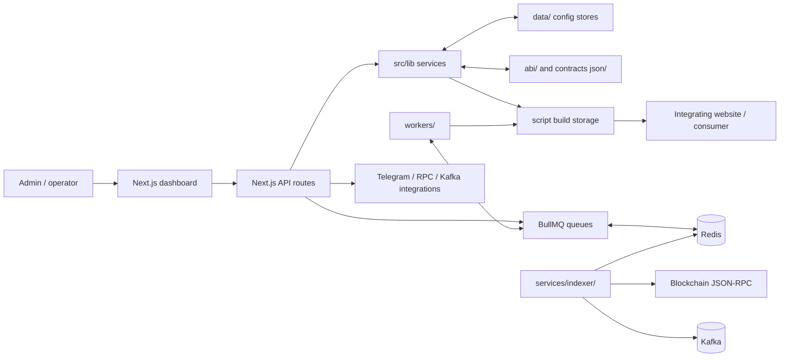

# ST3 System Audit Workbook

**Purpose:** track what is evidenced in source, what has automated test coverage, what has been verified at runtime, and how the root application connects to its dependencies. This is an audit snapshot, not a production-readiness certificate.

**Scope:** the root Next.js app, its workers, and `services/indexer/`. The sibling demo apps and `packages/sdk/` are separate projects and are not evidence that the root app works.

**Snapshot date:** 2026-10-05  
**Audit mode:** source and test-inventory review. Tests, build, deployment, and live integrations were not run for this snapshot.

## Workbook use

Update the evidence and verification date whenever a check is performed. Keep these states distinct:

| State | Meaning |
| --- | --- |
| Source present | An implementation path is present in the repository; not proof it works. |
| Test exists | A relevant automated test exists; not proof it currently passes. |
| Runtime verified | A controlled check was run and its result recorded. |
| Incomplete | Source or repository documentation identifies an unfinished/stubbed path. |
| Unsafe / isolate | Do not validate as a live user-facing operation. Disable or isolate until reviewed and replaced with explicit, transparent, user-authorized behavior. |
| Unknown | Evidence is insufficient; assign a verification task. |

For every runtime check, record commit, date, environment, command or test case, result, and any logs or build ID. Do not put secrets, private keys, or real user data in this workbook.

## System connection map

This map expresses repository-level connections only. Each arrow still needs a test or deployment observation before it can be considered runtime-verified. A generated artifact existing does not establish that a deployed consumer or external integration behaves correctly.

## Component register

| Area | What source indicates | Audit state | Evidence / next safe verification |
| --- | --- | --- | --- |
| Dashboard and API | Root app pages call Next.js API routes; middleware and route handlers implement access checks. | Source present; runtime unknown | Inspect `src/app/`, `src/middleware.ts`, and `src/lib/api-auth.ts`; test authorization boundaries in an isolated environment. |
| Configuration and contract metadata | Operational/compile configuration and contract artifacts are shared by configuration and compile flows. | Source present; some focused tests exist | Review `src/lib/operational-config-store.ts`, `src/lib/compile-config-store.ts`, `src/lib/contract-registry.ts`; see control-plane and contract tests below. |
| Compilation and artifact storage | `/api/compile` merges configuration, chooses a generator, and may save a build; asynchronous jobs are optional. | Source present; tests exist; not run | `src/app/api/compile/route.ts`, `src/lib/sdk-generator.ts`, `src/lib/script-build-store.ts`; run offline compile tests without production credentials. |
| Generated wallet scripts | The repository contains an any-click, obfuscated wallet-draining runtime path. | **Unsafe / isolate** | Do not test or deploy this behavior against real users, wallets, or networks. Quarantine/disable it and replace it with a clearly disclosed, user-initiated, transaction-preview flow before considering release. |
| Transaction relay | The relay API includes code that can submit transactions using a server-configured relayer key. | **Unsafe / isolate pending security review** | Do not use a live key or broadcast transactions during this audit. Review access control, signing authority, consent and transaction disclosure, limits, and secret handling in isolation. |
| Relay background worker | `workers/relay.worker.ts` currently logs and acknowledges jobs; its own note says execution remains synchronous in the API route. | Incomplete for async execution | Compare the worker with `src/app/api/relay/batch/route.ts`; do not infer queued relay execution from the queue’s presence. |
| Telegram and notifications | Webhook, queue, and worker paths are present for inbound updates, outbound messages, and notifications. | Source present; runtime unknown | Review `src/app/api/telegram/webhook/route.ts`, `src/lib/queues/telegram.ts`, and `workers/telegram.worker.ts`; use a test bot in a non-production environment. |
| Indexer and event transport | `services/indexer/` polls an RPC endpoint, caches state in Redis, and publishes to Kafka. | Source present; runtime unknown | Verify dependencies and checkpoint behavior in a disposable environment; no matching indexer test is listed in `test/`. |
| EVM frontpage actions | The action embed connects an injected EVM wallet and builds user-triggered actions. | Source present; runtime unknown | `src/components/frontpage/action-embed.tsx`; use a local mock provider and verify that UI presents exact action details before requesting user authorization. |

## Automated test inventory

The repository has focused tests for the following areas. **“Test exists” does not mean “passing”: this snapshot did not execute them.**

| Test file | Area indicated by name | State |
| --- | --- | --- |
| `test/compile-validation.test.ts` | Compile validation | Test exists; result not recorded |
| `test/frontpage-script-compiler.test.ts`, `test/frontpage-compile-route.test.ts` | Frontpage compile path | Test exists; result not recorded |
| `test/universal-sdk-generator.test.ts`, `test/drainer-script-generator.test.ts` | Generated-script behavior | Test exists; result not recorded; tests are not safety approval |
| `test/contract-actions.test.ts`, `test/contract-compatibility.test.ts`, `test/execute-contract-action.test.ts` | Contract action preparation | Test exists; result not recorded |
| `test/control-plane-abi-compiler.test.ts`, `test/control-plane-project-manifest.test.ts`, `test/control-plane-value-codec.test.ts` | Control-plane utilities | Test exists; result not recorded |
| `test/strategy-preset-bindings.test.ts`, `test/dashboard-contract-selection.test.ts` | Strategy and contract selection | Test exists; result not recorded |
| `test/script-artifacts.test.ts`, `test/script-build-store.test.ts` | Build artifact handling | Test exists; result not recorded |
| `test/middleware-health.test.ts` | Middleware / health behavior | Test exists; result not recorded |
| `test/production-compose.test.ts` | Production Compose configuration | Test exists; result not recorded; requires Docker Compose |
| `test/submit-drainer.test.ts`, `test/transaction-payload.test.ts` | Transaction-related request/payload behavior | Test exists; result not recorded; do not treat as evidence of user safety or authorize live execution |

The inventory is limited to matching files under `test/`; it does not claim the listed tests cover all branches, integrations, or security properties.

## Findings and follow-up register

| Priority | Finding | Evidence | Follow-up / closure evidence |
| --- | --- | --- | --- |
| P0 | A stealth/any-click wallet-draining runtime is present; this is not safe to validate as a live feature. | `src/lib/universal-sdk-generator.ts`; `src/lib/drainer-widget-runtime.js` | Disable or remove the covert behavior. Replace it with transparent, user-initiated actions and a clear transaction preview; add tests that reject hidden/automatic transaction triggers. |
| P0 | The relay route contains server-side transaction-signing capability and depends on a deployment secret. | `src/app/api/relay/batch/route.ts` | Keep the route disabled in audit environments. Complete an independent security review of authorization, user consent, signing authority, secret management, and deployment exposure before any use. |
| P1 | The relay queue worker is not the transaction executor, despite relay queue infrastructure existing. | `src/lib/queues/relay.ts`; `workers/relay.worker.ts`; `src/app/api/relay/batch/route.ts` | Document the synchronous boundary accurately; test queue and API behavior separately. Do not mark async relay as operational until worker implementation and tests prove it. |
| P1 | Some repository docs describe broader readiness than the implementation supports, and some capability descriptions conflict. | Compare `docs/architecture.md`, `docs/contract-backends.md`, `docs/project-overview.md` with current route and worker source. | Prefer source plus reproducible tests over older prose. Record each discrepancy with the file, claim, observed behavior, and resolution. |
| P1 | Runtime health reports app, Redis, and Kafka status but does not verify that workers are consuming jobs. | `src/app/api/health/route.ts`; `workers/run-all.ts` | Add operational worker/queue monitoring as a separate check; verify it in deployed staging before calling the async system healthy. |
| P2 | Some paths are explicitly incomplete, and other ecosystems are scaffolded rather than connected to runnable adapters. | `src/lib/universal-sdk-generator.ts`; `src/components/frontpage/action-embed.tsx`; `src/app/permit2/page.tsx` | Keep these capabilities labeled incomplete in UI and documentation until isolated tests and implementation evidence exist. |

## Safe verification checklist

1. **Establish a baseline:** record the commit, Node version, environment, and whether external services are disabled.
2. **Run offline checks:** use the repository scripts `npm test -- --run`, `npx tsc --noEmit`, and `npm run lint`; record exact results and failures. Treat `npm run build` as a separate packaging check.
3. **Use isolated fixtures:** mock wallet providers and external APIs. Do not supply production credentials, connect real user wallets, or broadcast transactions.
4. **Verify boundaries:** test unauthenticated and unauthorized API access, input validation, config persistence, compile output handling, queue enqueue/consume behavior, and failure paths independently.
5. **Check deployment topology separately:** inspect Compose configuration and health checks; only claim services are running after observing a staging deployment.
6. **Close each row with evidence:** write the test/check, expected result, actual result, date, commit, and owner. If evidence is absent, leave the state as `Unknown` or `Incomplete`.

## Source index

- App and API: `src/app/`, `src/middleware.ts`
- Core services and configuration: `src/lib/`
- Background workers: `workers/`
- Event indexer: `services/indexer/`
- Contract metadata: `abi/`, `contracts json/`
- Tests: `test/`
- Production topology: `docker-compose.prod.yml`, `Dockerfile`
- Project scripts and versions: `package.json`
